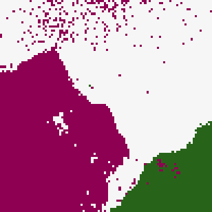
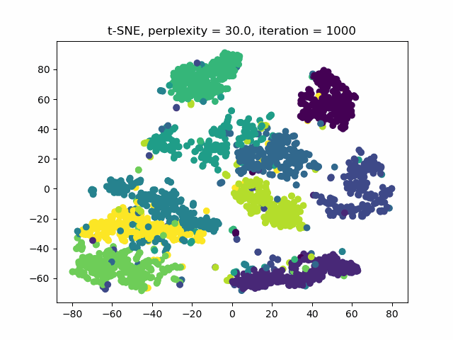
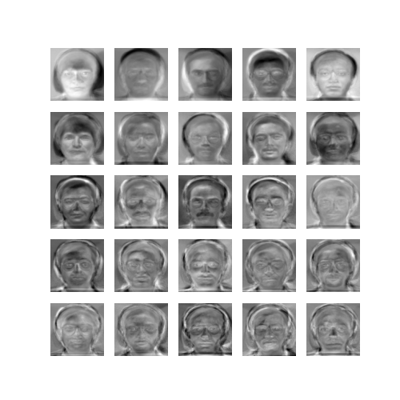
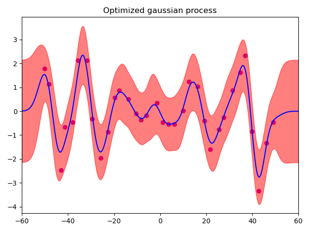

# ML From Scratch

Implementations of classical machine learning algorithms, built from the ground up as coursework.

HW1–HW4 use **no ML libraries** — all linear algebra, optimization, and probabilistic models are hand-coded in pure Python or C++. HW5–HW7 focus on kernel methods and dimensionality reduction, using scipy/libsvm/CuPy for numerical utilities while implementing the core algorithms manually.

## Course Information

| | |
|---|---|
| **Course** | Machine Learning |
| **Institution** | National Yang Ming Chiao Tung University (NYCU) |
| **Instructors** | Prof. Jui-Hung Hung, Prof. Walon Chiu |
| **Semester** | 2024 Spring |

## Selected Results

| [Kernel K-means segmentation](spectral-clustering/README.md#kernel-k-means-1) | [t-SNE embedding](kernel-eigenfaces/README.md#part-3-t-sne-vs-symmetric-sne) | [Eigenfaces](kernel-eigenfaces/README.md#part-1-eigenfaces--fisherfaces) | [Gaussian process regression](gaussian-process-and-svm/README.md#results) |
|:---:|:---:|:---:|:---:|
|  |  |  |  |

## Projects

| Directory | Topic | Language | Key Algorithms |
|-----------|-------|----------|----------------|
| [linear-regression](linear-regression/) | Polynomial Regression | Python | Ridge LSE (closed form via LU inverse), LASSO by steepest descent, Newton's method — hand-built `Matrix` class, no NumPy |
| [naive-bayes](naive-bayes/) | Naive Bayes & Beta-Binomial | Python | Discrete and Gaussian Naive Bayes on MNIST, Welford's online variance, Beta-Binomial online learning — no NumPy |
| [bayesian-estimation](bayesian-estimation/) | Bayesian Linear Regression | C++ | Gaussian data generator, sequential estimator, online Bayesian posterior and predictive updates — hand-built `Matrix` class |
| [logistic-regression-and-em](logistic-regression-and-em/) | Logistic Regression & EM | C++ | Logistic regression (gradient descent / Newton's method), EM for a Bernoulli mixture clustering MNIST — hand-built `Matrix` class |
| [gaussian-process-and-svm](gaussian-process-and-svm/) | Gaussian Process & SVM | Python | GP with rational quadratic kernel and marginal-likelihood tuning; SVM grid search and a precomputed linear+RBF kernel |
| [spectral-clustering](spectral-clustering/) | Image Segmentation | Python | Kernel K-means with kmeans++, spectral clustering (ratio cut / normalized cut) — CuPy GPU acceleration |
| [kernel-eigenfaces](kernel-eigenfaces/) | Eigenfaces & t-SNE | Python | PCA, LDA, kernel PCA/LDA, k-NN face recognition; t-SNE vs. symmetric SNE — CuPy GPU acceleration |

## Note

These are my solutions to the course assignments, shared as a portfolio.
If you are currently taking this course, please do not copy them.
