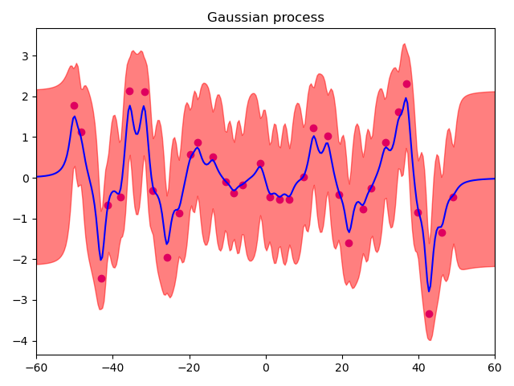

# Gaussian Process Regression & SVM

Gaussian Process regression with marginal-likelihood hyperparameter tuning, and SVM classification on MNIST with grid search and a custom kernel.

## Part 1: Gaussian Process Regression

### Approach

**Kernel** — rational quadratic:

$$k(x_i, x_j) = \left( 1 + \frac{\lVert x_i - x_j \rVert^2}{2 \alpha l^2} \right)^{-\alpha}$$

**Noise** — the covariance of the training targets is $C = K + \beta^{-1} I$, with $\beta = 5$.

**Prediction** at 300 test points $x_{\ast}$ in $[-60, 60]$:

$$\mu(x_{\ast}) = k(X, x_{\ast})^\top C^{-1} y$$

$$\sigma^2(x_{\ast}) = k(x_{\ast}, x_{\ast}) + \beta^{-1} - k(X, x_{\ast})^\top C^{-1} k(X, x_{\ast})$$

**Hyperparameter optimization** — minimizes the negative log marginal likelihood over $(\alpha, l)$, using `scipy.optimize.minimize`:

$$-\ln p(y \mid \alpha, l) = \frac{1}{2} \left( \ln \lvert C \rvert + y^\top C^{-1} y + N \ln 2\pi \right)$$

The kernel, the posterior, and the likelihood are all written by hand in NumPy. SciPy is used only as the optimizer.

### Results

| Initial $\alpha = l = 1$ | Optimized $\alpha, l$ |
|:---:|:---:|
|  |  |

*Blue: predicted mean. Red band: 95% confidence interval.*

With the default hyperparameters, the model overfits: the mean chases every training point and the band swings sharply between them. With optimized hyperparameters, both the mean and the band are much smoother.

## Part 2: SVM on MNIST

Uses [libsvm](https://github.com/cjlin1/libsvm) on MNIST images of 784 features each, read from CSV.

- **Mode 1**: Compares linear, polynomial, and RBF kernels at libsvm defaults.
- **Mode 2**: Grid-searches $C$, $\gamma$, degree, and `coef0` for each kernel with 3-fold cross-validation, then retrains the best model and tests it.
- **Mode 3**: Builds a custom **linear + RBF** kernel by hand, then passes the precomputed Gram matrix to libsvm (`-t 4`).

### Observations

- At libsvm defaults, the polynomial kernel performed worst of the three. It has the most hyperparameters, and untuned it generalizes poorly.
- Grid search picks the model with the best cross-validation accuracy. If the search range includes very complex settings, a model that overfits can still win that comparison and then do worse on the test set. That is why the search range matters.

## Usage

```bash
python gaussian_process.py              # needs input.data
python support_vector_machine.py 1|2|3  # needs X_train.csv, Y_train.csv, X_test.csv, Y_test.csv
```

## Files

- `gaussian_process.py` — GP regression and hyperparameter optimization
- `support_vector_machine.py` — Kernel comparison, grid search, and custom kernel
