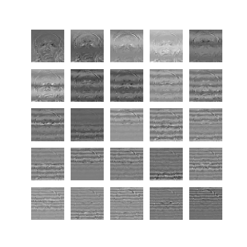
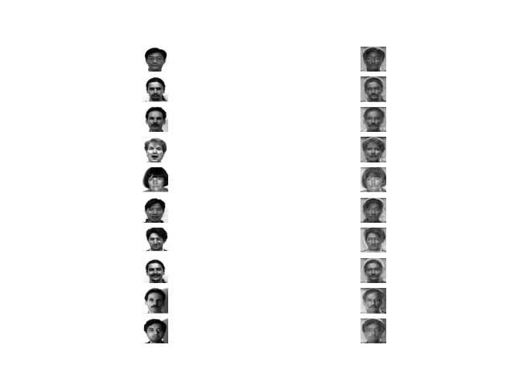
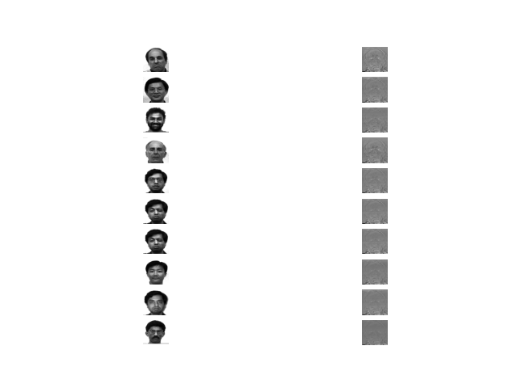
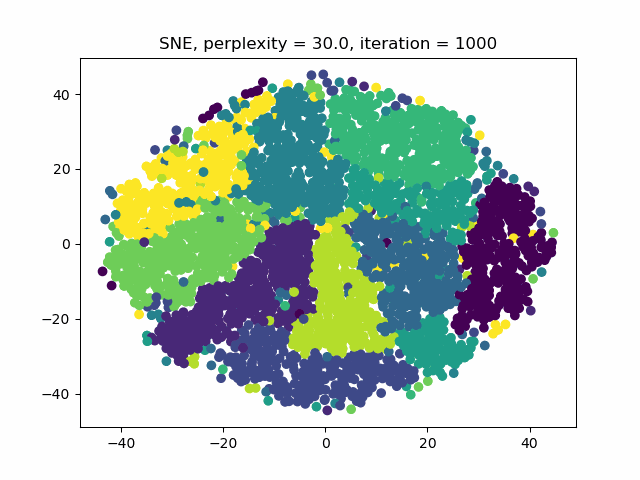
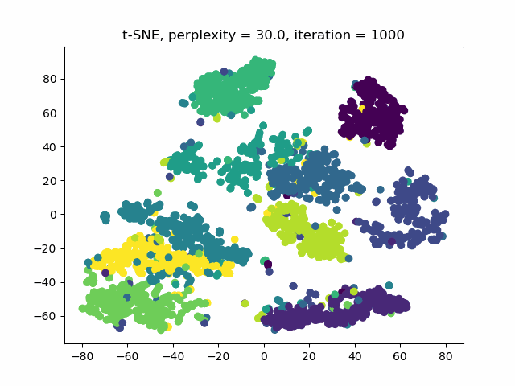

# Kernel Eigenfaces & t-SNE

Face recognition on the Yale Face Database with PCA, LDA, and their kernel versions, plus t-SNE and symmetric SNE visualizations of MNIST. The linear algebra runs on the GPU via CuPy when one is available.

## Part 1: Eigenfaces & Fisherfaces

Faces from 15 subjects are resized (the `SIZE` constant, 50×50 by default; the figures below come from a 100×100 run), and each method keeps 25 components.

- **PCA (eigenfaces)**: Takes the top eigenvectors of the data covariance. There are far fewer images than pixels, so it decomposes the small `n × n` matrix `XXᵀ` and maps the eigenvectors back to pixel space.
- **LDA (fisherfaces)**: Takes the top eigenvectors of `S_w⁺ S_b` (the pseudo-inverse of the within-class scatter times the between-class scatter).

| Eigenfaces | Fisherfaces |
|:---:|:---:|
|  |  |

Reconstruction from the 25 components (left: original, right: reconstructed):

| PCA | LDA |
|:---:|:---:|
|  |  |

## Part 2: Face Recognition with Kernel PCA / LDA

Test faces are projected into each subspace and classified with k-NN (k = 3, 5, 7). Two kernels are supported:

- **Linear** kernel `XYᵀ`
- **RBF** kernel `exp(−γ‖x − y‖²)`

For kernel PCA, the Gram matrix is centered in feature space. For kernel LDA, the scatter matrices are built in kernel space.

### Results

k-NN accuracy on the 30-image test set, at two input resolutions:

| Method | 100×100, k=3 | k=5 | k=7 | 65×77, k=3 | k=5 | k=7 |
|---|:---:|:---:|:---:|:---:|:---:|:---:|
| PCA | 0.83 | **0.90** | **0.90** | 0.83 | **0.90** | **0.90** |
| LDA | 0.87 | 0.83 | 0.83 | 0.87 | 0.83 | 0.83 |
| Kernel PCA (RBF) | 0.60 | 0.63 | 0.57 | 0.80 | 0.80 | 0.83 |
| Kernel LDA (linear) | 0.70 | 0.63 | 0.67 | 0.70 | 0.60 | 0.60 |
| Kernel LDA (RBF) | 0.50 | 0.47 | 0.50 | 0.73 | 0.80 | 0.77 |

- Plain PCA does best overall, reaching 90% with k = 5 or 7.
- Resolution doesn't affect plain PCA or LDA, but the RBF-kernel methods improve noticeably at 65×77. The likely reason is that 65×77 divides the original 195×231 evenly, so resizing is cleaner.

A `@gpu_accelerated` decorator moves NumPy arguments to CuPy and moves the results back, so the algorithms themselves are written only once.

## Part 3: t-SNE vs. Symmetric SNE

This part starts from van der Maaten's reference `tsne.py`, keeping its attribution header. It adds a symmetric SNE mode (Gaussian similarities in the low-dimensional space instead of Student-t), saves an animation of the optimization, and plots the high- and low-dimensional similarity distributions. It runs on 2,500 MNIST digits.

| Symmetric SNE | t-SNE |
|:---:|:---:|
|  |  |

Symmetric SNE shows the **crowding problem**: all 10 digit classes are packed together into one disk. The heavy tails of t-SNE's Student-t distribution let dissimilar points sit far apart, so the classes separate into distinct clusters.


## Usage

```bash
python kernel_eigenfaces.py            # needs Yale_Face_Database/{Training,Testing}/
python tsne_sne.py t-SNE|SNE <perplexity>   # needs tsne_python/mnist2500_{X,labels}.txt
```

## Files

- `kernel_eigenfaces.py` — PCA, LDA, kernel PCA/LDA, and k-NN recognition
- `tsne_sne.py` — t-SNE / symmetric SNE (extends van der Maaten's reference implementation)
