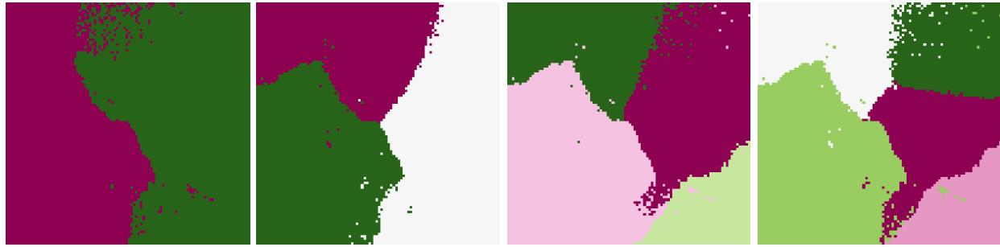
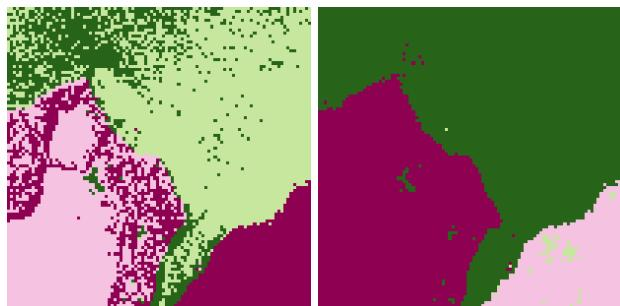
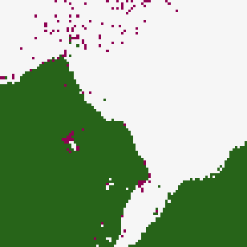
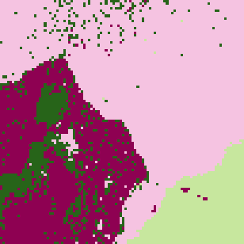
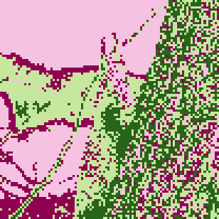
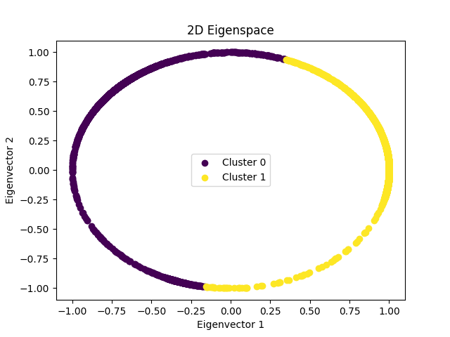
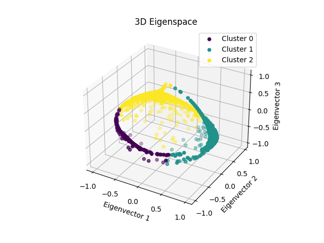

# Spectral Clustering & Kernel K-Means

Image segmentation of two 100×100 images using kernel K-means and spectral clustering. The eigendecomposition runs on the GPU via CuPy when one is available.

## Approach

### Kernel K-Means

The similarity between two pixels combines an RBF kernel on their spatial coordinates $s(x)$ and one on their colors $c(x)$:

$$k(x, x') = \exp\left( -\gamma_s \lVert s(x) - s(x') \rVert^2 \right) \cdot \exp\left( -\gamma_c \lVert c(x) - c(x') \rVert^2 \right)$$

- **Initialization**: Either random, or **kmeans++**, which picks each new centroid with probability based on how far it is from the existing ones in kernel space.
- **Iteration**: Distances to each cluster are computed entirely from the Gram matrix, and points are reassigned until only a few labels change per iteration.
- Every iteration's segmentation is saved as a frame of a GIF.

### Spectral Clustering

Builds a similarity graph $W$ from the same kernel, then uses one of two Laplacians:

1. **Ratio cut**: $L = D - W$
2. **Normalized cut**: $L_{\text{sym}} = I - D^{-1/2} W D^{-1/2}$, with the rows of the eigenvector matrix normalized to unit length afterward.

The program takes the $k$ eigenvectors with the smallest eigenvalues, skipping the trivial one. It then runs kernel K-means on the points in that eigenspace. The eigendecomposition of the 10,000×10,000 Laplacian is the bottleneck. It runs on CuPy if a GPU is present and on NumPy otherwise.

## Results

### Kernel K-means

`image1.png` with 2 to 5 clusters (random initialization, $\gamma_s = 10^{-3}$, $\gamma_c = 10^{-4}$):



- 3 to 4 clusters describe this image best.
- Random initialization and kmeans++ usually converge to similar segmentations; kmeans++ is sometimes slightly better.

Iterations of kernel K-means (the first frame shows the final result):

| Input | Kernel K-means |
|:---:|:---:|
|  |  |
| `image1.png` | 3 clusters, kmeans++, $\gamma_s = \gamma_c = 10^{-4}$ |
|  |  |
| `image2.png` | 4 clusters, kmeans++, $\gamma_s = \gamma_c = 10^{-3}$ |

### Spectral Clustering

Normalized cut (left) vs. ratio cut (right) on `image1.png`. The normalized cut picks up finer detail.



Iterations of K-means in the eigenspace (the first frame shows the final result). Because the eigenvectors already separate the pixels well, it converges in far fewer iterations than kernel K-means on the raw pixels.

`image1.png`:

| Input | 3 clusters | 4 clusters |
|:---:|:---:|:---:|
|  |  |  |
| | kmeans++, $\gamma_s = \gamma_c = 10^{-3}$ | random, $\gamma_s = \gamma_c = 10^{-4}$ |

`image2.png`:

| Input | 2 clusters | 3 clusters | 4 clusters |
|:---:|:---:|:---:|:---:|
|  |  |  |  |
| | random, $\gamma_s = \gamma_c = 10^{-4}$ | kmeans++, $\gamma_s = \gamma_c = 10^{-4}$ | kmeans++, $\gamma_s = \gamma_c = 10^{-4}$ |

Data points of `image1.png` in the eigenspace, colored by cluster:

| 2 clusters | 3 clusters |
|:---:|:---:|
|  |  |

## Usage

```bash
python kernel_kmeans.py
python spectral_clustering.py
```

## Files

- `kernel_kmeans.py` — Kernel K-means, kmeans++, and kernel construction
- `spectral_clustering.py` — Ratio cut and normalized cut spectral clustering
- `image1.png`, `image2.png` — Input images
