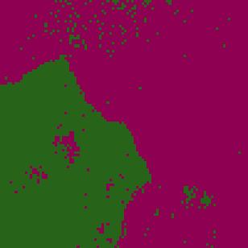
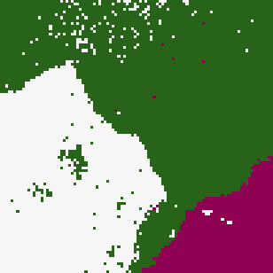
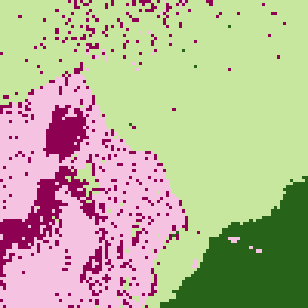

# Spectral Clustering & Kernel K-Means

Image segmentation of two 100×100 images using kernel K-means and spectral clustering. The eigendecomposition runs on the GPU via CuPy when one is available.

## Approach

### Kernel K-Means

- **Similarity**: A kernel combining spatial and color RBFs, computed per pixel pair:

  `k(x, x′) = exp(−γₛ‖s(x) − s(x′)‖²) · exp(−γ_c‖c(x) − c(x′)‖²)`

- **Initialization**: Either random, or **kmeans++**, which picks each new centroid with probability based on how far it is from the existing ones in kernel space.
- **Iteration**: Distances to each cluster are computed entirely from the Gram matrix, and points are reassigned until only a few labels change per iteration.
- Every iteration's segmentation is saved as a frame of a GIF.

### Spectral Clustering

Builds a similarity graph `W` from the same kernel, then uses one of two Laplacians:

1. **Ratio cut**: `L = D − W`
2. **Normalized cut**: `L_sym = I − D^(−1/2) W D^(−1/2)`, with the rows of the eigenvector matrix normalized to unit length afterward.

The program takes the `k` eigenvectors with the smallest eigenvalues, skipping the trivial one. It then runs kernel K-means on the points in that eigenspace. The eigendecomposition of the 10,000×10,000 Laplacian is the bottleneck. It runs on CuPy if a GPU is present and on NumPy otherwise.

## Results

### Kernel K-means

`image1.png` with 2 to 5 clusters (random initialization, `γₛ = 10⁻³`, `γ_c = 10⁻⁴`):


- 3 to 4 clusters describe this image best.
- Random initialization and kmeans++ usually converge to similar segmentations; kmeans++ is sometimes slightly better.

### Spectral Clustering

Normalized cut (left) vs. ratio cut (right) on `image1.png`. The normalized cut picks up finer detail.


Spectral clustering on `image1.png` (each GIF shows the iterations):

| 2 clusters | 3 clusters | 4 clusters |
|:---:|:---:|:---:|
|  |  |  |

Spectral clustering on `image2.png`:

| 2 clusters | 3 clusters |
|:---:|:---:|
|  |  |

Data points in the eigenspace, colored by cluster:

| 2 clusters | 3 clusters |
|:---:|:---:|
|  |  |

## Usage

```bash
python kernel_kmeans.py
python spectral_clustering.py
```

## Files

- `kernel_kmeans.py` — Kernel K-means, kmeans++, and kernel construction
- `spectral_clustering.py` — Ratio cut and normalized cut spectral clustering
- `image1.png`, `image2.png` — Input images
